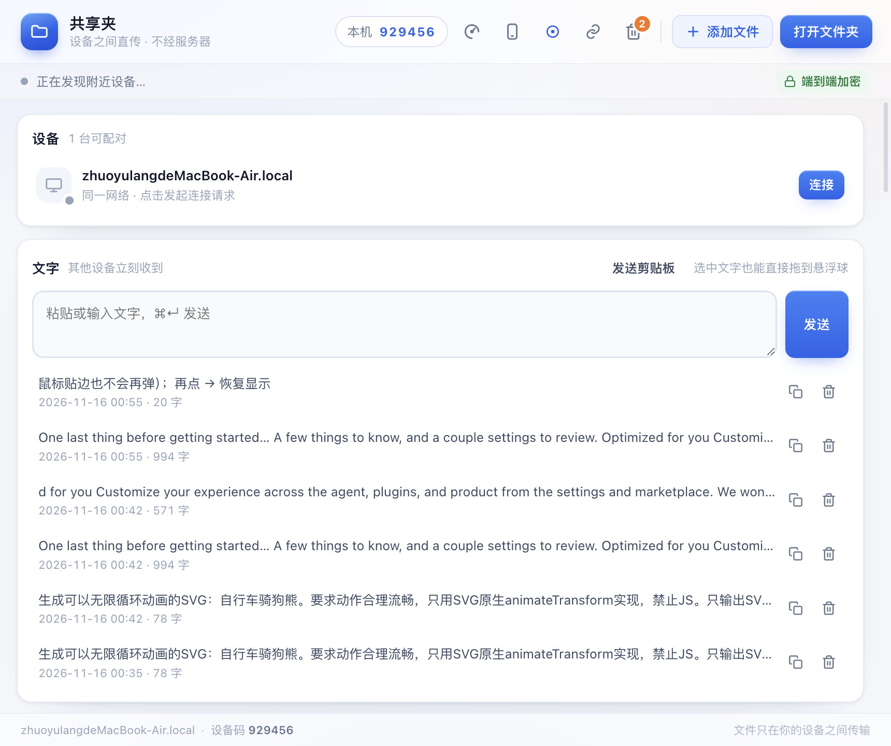
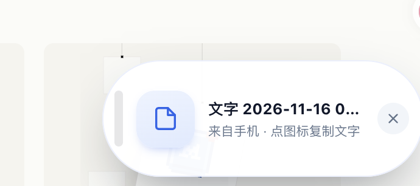
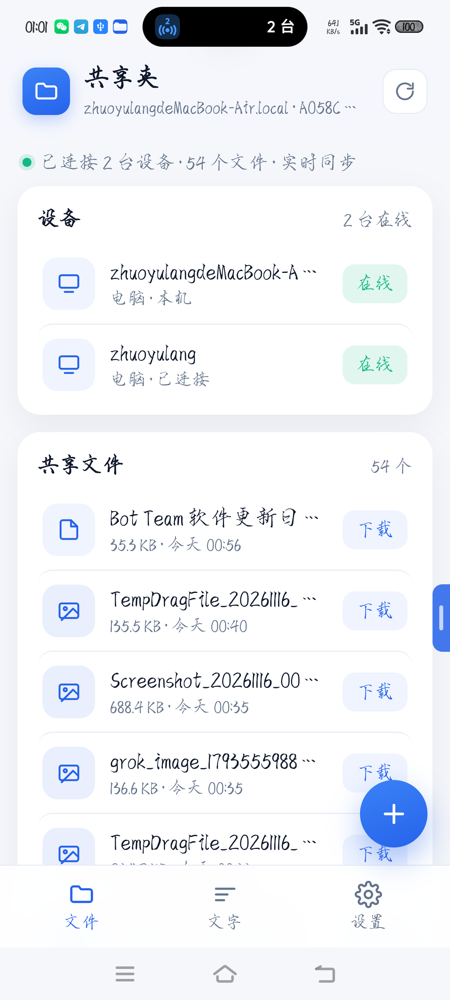
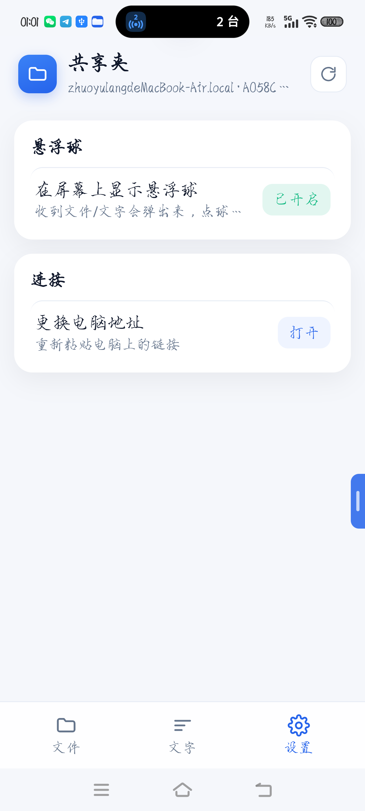

# 共享夹

**把文件"扔"给另一台设备，就像把纸丢进同一个抽屉。**

Windows / macOS / 安卓 / 平板 / 网页，同一个局域网内互联。文件**不经服务器**、**不登录账号**、**不压缩画质**，直接从 A 设备到 B 设备。

---

## 为什么比微信的「文件传输助手」方便

| 场景 | 共享夹 | 微信文件传输助手 |
|------|--------|-----------------|
| 发一张截图 | **点悬浮球 → 发送最近的文件**（2 步） | 打开微信 → 找传输助手 → ＋ → 相册 → 选图 → 发送（5 步） |
| 是否要离开当前界面 | **不用**，悬浮球浮在任何 App 之上 | 必须切到微信 |
| 电脑收文件 | 桌面悬浮球弹出，**点一下复制 / 拖出去**直接用 | 打开微信客户端 → 找到对话 → 另存为 → 再打开 |
| 文件保存位置 | 落到 `下载/共享夹`，或用完即走 | 埋在微信的缓存目录里 |
| 两台电脑互传 | **直接 P2P**，不经过任何第三方 | 不支持（要经过微信服务器） |
| 多设备 | 手机、平板、Mac、Windows 同时在线，谁发都行 | 只能靠微信自己登录的设备 |
| 大文件 / 断点续传 | 支持，分片校验、断点续传 | 受微信限制 |
| 历史版本 / 回收站 | 每次覆盖自动留版本，删除进回收站 | 没有 |
| 画质 | **原图原文件**，不转码不压缩 | 图片会被压缩 |
| 服务器 / 账号 | 全程局域网直连，无需账号 | 必须联网、必须登录 |

一句话：**微信是"发消息顺便传文件"，共享夹是"文件本来就在手边，随手一扔"。**

---

## 它长什么样

### 电脑端：设备列表 + 文字快传



- 「设备」列出同一网络里的所有设备，点 **连接** 发起配对，对方点 **接受** 即连上
- 「文字」面板：电脑上复制的内容直接发到所有设备，手机点一下就能粘贴
- 文件列表：**单击复制、双击打开、可拖出**

### 悬浮球：平时贴边隐身，有事才冒头



- 鼠标贴到屏幕边缘 **0.4 秒**浮现，离开自动收起
- 有文件/文字进来时自动弹出，显示名称与来源
- 点图标 = 复制（文字复制文字，文件复制文件本体）
- 拖到桌面 = 直接拿到文件
- 主界面右上角 `◎` 可一键显示/隐藏

### 手机端：文件、文字、设备一屏看全



- 底部三个 Tab：**文件 / 文字 / 设置**
- 「设备」卡片实时列出在线设备
- 文件点一下下载到 `下载/共享夹`
- 手机屏幕上有一条**贴边小条**，往外一拉就是悬浮球



---

## 功能清单

**同步与传输**
- 局域网自动发现 + P2P 直连（AES-256-GCM 加密，令牌鉴权）
- 分片传输、断点续传、秒传（同内容只存一份）
- 多设备同时在线，任意一端发送，其余设备立刻收到
- 手机 ↔ 电脑、电脑 ↔ 电脑 直接互发

**文件管理**
- 单击复制 / 双击打开 / 拖出到桌面
- 同名文件自动升级版本，保留历史，可回滚
- 删除进回收站，可恢复
- 冲突副本自动标记

**文字快传**
- 任意设备发一段文字，其他设备点一下即复制
- 快捷键 `⌘/Ctrl+Alt+S` 直接发送剪贴板
- 手机可从面板直接「发送剪贴板」

**悬浮球**
- 电脑：贴边浮现、拖拽、吞文件、进度环、收到卡片
- 手机：贴边小条 → 拉出球 → 点球发文件/文字；收到东西单击复制、双击打开

**安卓 App**
- 分享/打开方式接入：任何 App 里「分享 → 共享夹」或「打开 → 共享夹」直接发到电脑
- 拖文件到贴边小条 **不打开 App 直接发送**
- 长按桌面图标有「发送文件到电脑」快捷方式

---

## 下载安装

前往 [Releases](../../releases) 页面：

| 平台 | 文件 | 说明 |
|------|------|------|
| Android | `共享夹-Android.apk` | 直接安装（需允许"安装未知来源应用"） |
| Windows | `共享夹-Windows-x64.zip` | 解压后运行 `共享夹.exe` |
| macOS | `共享夹-macOS.zip` | 解压后拖进「应用程序」；首次打开右键 → 打开 |

> macOS 首次运行会请求「访问文稿文件夹」和「显示在其他应用上层」，用于扫描共享夹和悬浮球。

### 第一次使用

1. 电脑打开共享夹 → 右上角「打开文件夹」选定共享目录
2. 另一台电脑：主界面「设备」里点 **连接** → 对方点 **接受**
3. 手机：电脑上点「手机访问」复制链接 → App 里粘贴 → 连接
4. 之后手机/平板可以直接在「设置」里重新连接

---

## 从源码构建

### 桌面端（Electron）

```bash
cd desktop
npm install
npm start                      # 开发运行
bash build/build-all.sh        # 打包 macOS + Windows
```

产物在 `dist/`。

### 安卓端

```bash
cd android
./gradlew assembleRelease      # 需要 Android SDK 34 + JDK 17
```

> 仓库不含签名密钥，构建 release 前请在 `app/build.gradle` 配置你自己的 keystore。

---

## 目录结构

```
desktop/          Electron 桌面端
  src/main.js       主进程：P2P、悬浮球、手机网页服务、托盘
  src/peer.js       P2P 引擎：发现、加密、分片、版本、回收站
  src/renderer/     主界面 + 悬浮球界面
  src/web/          手机网页版
  build/            图标与打包脚本
android/          安卓客户端（WebView + 原生节点/悬浮球）
  app/src/main/java/com/gongxiangjia/app/
    MainActivity.java   连接、分享接收、发送面板入口
    BallService.java    系统悬浮窗（贴边小条 + 悬浮球 + 拖放接收）
    NodeServer.java     手机端文件节点（其他设备可直发）
    Discovery.java      局域网 UDP 发现
```

---

## 隐私与安全

- **不经过任何服务器**：数据只在你的局域网内流转
- 传输使用 **AES-256-GCM** 端到端加密，设备之间自行协商密钥
- 手机网页版与节点接口都需要**一次性令牌**（每次安装随机生成）
- 不收集任何使用数据，不需要注册账号

---

## 已知限制

- 需要设备在**同一个局域网**（同一 WiFi / 热点）
- 安卓的「分享 → 共享夹」入口在部分国产 ROM 的分享面板里位置较深（系统行为）
- 微信内部的拖拽（拖到屏幕顶部那一条）是微信/手机厂商私有协议，第三方应用无法接入
- iOS 目前通过浏览器访问网页版，暂无原生包

---

## 许可证

[MIT](LICENSE) © zhuoyulang
